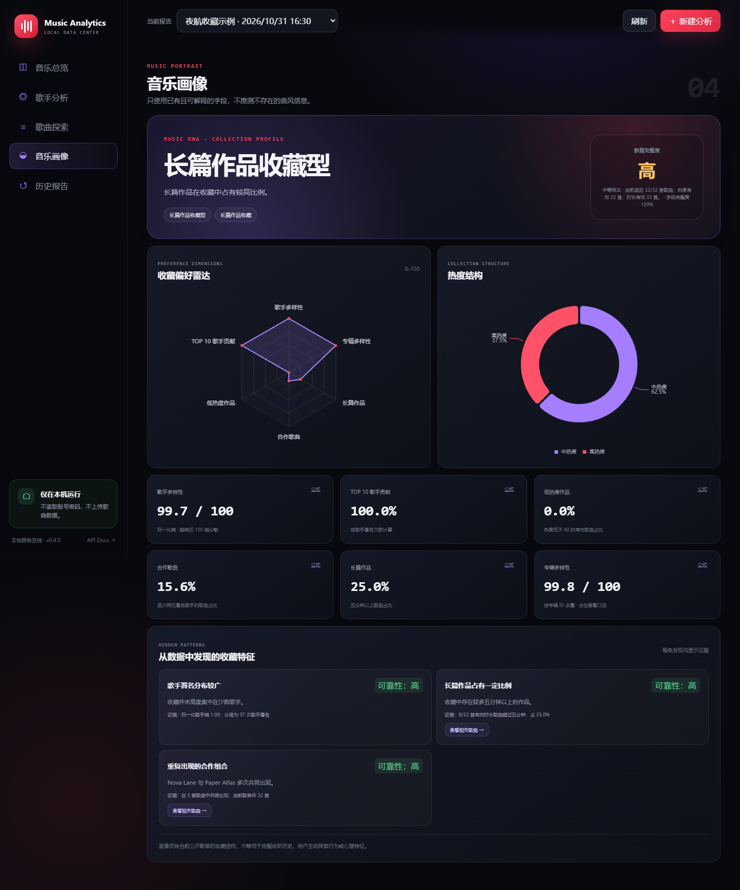

# NetEase Music Analytics

一个**本地运行、浏览器查看、以数据可信度为核心**的网易云音乐歌单分析工具。

它同时保留 Codex Skill 和命令行能力，并提供完整的本地 Web 界面：

- 每位歌手的歌曲数量
- 同名歌曲分组
- 时长最长、最短歌曲
- 热度最高、最低歌曲及并列项
- 全部歌曲明细
- 可核验的 CSV 与 Markdown 报告
- 一键下载包含全部 CSV、JSON、Markdown 和原始数据的 ZIP 文件
- 下载后给出可复制的提示词，可把统计文件交给 AI 评价音乐品味
- 歌手、时长和热度可视化
- 每页 15 位的歌手排行，避免长列表拖慢页面
- 基于统计规则和证据的 Music DNA 音乐画像
- 历史报告与两次分析结果比较


## Music DNA

音乐画像不会根据歌曲名称给用户贴心理标签，而是从真实字段中计算：

- 歌手归一化熵和集中度
- TOP 10 歌手署名贡献
- 低热度作品比例
- 合作歌曲比例
- 长篇与短篇作品比例
- 专辑广度和热度结构

每个画像结论都会附带指标证据、有效样本量和可靠性。数据完整度、样本充分度与结论可靠性分开计算；少于 10 首歌曲时不会生成强画像结论。



## 为什么需要这个技能

网易云客户端只会渲染当前可见的少量歌曲。如果通过滚动页面统计，很容易漏掉大量曲目。

本技能直接读取歌单的完整 `trackIds`，再按每批 200 首获取歌曲详情。这样既能快速处理数千首歌曲，也能检查返回数量和缺失项。

## 快速开始

### 本地 Web 应用

需要 Python 3.10 或更高版本。

```powershell
pip install -r requirements.txt
python run.py
```

Windows 用户也可以在项目目录直接双击 `start.cmd`。它会复用项目内的 `.venv` 并启动服务。

程序默认只监听 `127.0.0.1:8765`，并自动打开：

```text
http://127.0.0.1:8765
```

输入公开歌单链接后，页面会显示真实的采集进度、完整性状态和统计结果。所有数据都保存在本机 `outputs/web/`。

默认勾选“完成后自动下载全部文件”。分析结束后浏览器会下载一个 ZIP，包含歌曲明细、歌手统计、同名歌曲、时长与热度极值、摘要、元数据和原始数据。

如果不希望自动打开浏览器：

```powershell
python run.py --no-browser
```

### Codex

把仓库克隆到 Codex 技能目录：

```powershell
git clone https://github.com/selurua223/netease-liked-music-stats.git "$env:USERPROFILE\.codex\skills\netease-liked-music-stats"
```

重新打开 Codex，然后使用：

```text
使用 $netease-liked-music-stats 统计这个公开网易云歌单：[歌单链接或 ID]
```

也可以直接把 `netease-liked-music-stats` 文件夹放入：

```text
%USERPROFILE%\.codex\skills
```

### 命令行

需要 Python 3.10 或更高版本，仅使用标准库，无需安装第三方依赖。

```bash
python scripts/netease_liked_stats.py \
  --playlist-id PLAYLIST_ID \
  --out-dir outputs/PLAYLIST_ID
```

PowerShell：

```powershell
python .\scripts\netease_liked_stats.py `
  --playlist-id PLAYLIST_ID `
  --out-dir .\outputs\PLAYLIST_ID
```

## 输出文件

| 文件 | 内容 |
|---|---|
| `report.md` | 人类可读的统计摘要 |
| `summary.json` | 完整统计结构，包含全部并列极值 |
| `songs.csv` | 全部歌曲及其歌手、专辑、时长、热度 |
| `artist_counts.csv` | 全部歌手的歌曲数量排名 |
| `duplicate_titles.csv` | 全部同名歌曲及其专辑信息 |
| `extrema.csv` | 时长与热度的完整极值清单 |
| `raw_data.json` | 原始歌单、歌曲详情、请求 ID 和缺失 ID，可选择关闭 |
| `songs.json` | Web 界面使用的标准化歌曲数据 |
| `metadata.json` | 分析时间、版本、完整性和来源信息 |
| `README.txt` | 仅 ZIP 内：文件说明，以及发给 AI 的提示词 |

## 把文件交给 AI，评价音乐品味

统计只负责把数据算准；“这些收藏说明了什么品味”更适合交给 AI 助手。下载 ZIP 后有两种方式拿到说明：

- 压缩包里的 `README.txt` 含一段可直接复制的提示词，以及每个文件什么时候该发。
- Web 界面第一次下载完成后会自动弹出「用 AI 解读」，报告顶部也可随时打开，并支持一键复制提示词。

提示词会让 AI 先读 `summary.json` 的 `overview`、`artistCounts`、`duplicateTitles` 和 `profile`，然后：

1. 概括歌手集中度、热度分布、时长结构、合作比例和专辑跨度；
2. 给出带具体数字证据的口味推断；
3. 先根据 `integrity.status` 和缺失数量判断数据是否完整，再指出其他局限（热度分值饱和、同名歌曲只按标题匹配、样本量是否足够）；
4. 推荐还没收藏的歌手和专辑。

推荐发送顺序：`summary.json`（信息最全，单独发也够）→ `report.md`（人类可读摘要）→ `songs.csv`（需要逐首分析时再发）。这些文件只包含公开歌单数据，不含账号、Cookie、音频或设备信息，只有你主动发送时才会离开本机。

## 技术架构

```text
Web 前端
  ↓ HTTP / JSON
FastAPI 本地服务
  ↓
AnalysisService / TaskService
  ↓
collector → normalizer → statistics → integrity
  ↓
JSON / CSV / Markdown 本地报告
```

核心统计代码位于 `src/netease_stats/core/`，Web 和 CLI 使用同一套实现，避免两套结果不一致。

## 本地 API

| 方法 | 路径 | 功能 |
|---|---|---|
| `GET` | `/api/health` | 服务状态 |
| `GET` | `/api/ai-guide` | 可发给 AI 的解读提示词与文件建议 |
| `POST` | `/api/analyze` | 创建分析任务 |
| `GET` | `/api/tasks/{id}` | 查询真实任务进度 |
| `GET` | `/api/reports` | 列出本地报告 |
| `GET` | `/api/reports/{id}` | 获取统计摘要 |
| `GET` | `/api/reports/{id}/songs` | 搜索、筛选和分页歌曲 |
| `GET` | `/api/reports/{id}/export` | 下载 CSV、JSON 或 Markdown |
| `GET` | `/api/reports/{id}/download-all` | 一键下载全部统计文件 ZIP |
| `GET` | `/api/reports/{id}/compare/{other_id}` | 比较两次报告 |

交互式 API 文档位于 `http://127.0.0.1:8765/api/docs`。

歌曲查询支持 `song_ids=1,2,3`，用于从画像发现直接定位相关歌曲。

## Music DNA 计算口径

### 数据质量

- **数据完整度**：成功返回的歌曲比例，以及热度、时长、专辑字段的有效覆盖率。
- **样本充分度**：少于 10 首为不充分；10–29 首为有限；30–99 首为中等；100 首以上为充分。
- **结论可靠性**：结合样本量和对应字段覆盖率计算，每条发现独立判断。

### 核心指标

- **歌手多样性**：歌手署名分布的归一化 Shannon 熵
  `H = -Σ pᵢ ln(pᵢ) / ln(n)`
- **歌手集中度 HHI**：`Σ pᵢ²`
- **TOP 10 歌手贡献**：TOP 10 歌手署名次数 / 全部歌手署名次数
- **低热度作品比例**：热度小于 40 的有效歌曲 / 有效热度歌曲
- **合作歌曲比例**：至少两位有效署名歌手的歌曲 / 全部歌曲
- **长篇作品比例**：五分钟以上有效歌曲 / 有效时长歌曲
- **专辑多样性**：优先按专辑 ID 去重后的专辑分布归一化 Shannon 熵

所有比例都会在画像指标弹窗中显示分子、分母、有效样本和缺失数量。

### 小样本保护

| 有效歌曲数 | 画像行为 |
|---:|---|
| 少于 10 首 | 只展示基础统计，不生成强画像发现 |
| 10–29 首 | 只生成有限且带提示的发现 |
| 30–99 首 | 可生成一般画像 |
| 100 首以上 | 可生成相对稳定画像 |

热度只接受数值型的 `0–100` 范围；异常值不会进入画像计算。

## 安全边界

- 服务只允许绑定回环地址，默认不开放局域网。
- 不使用网易云账号密码或 Cookie。
- 不上传歌曲、报告或缓存到第三方服务器。
- 报告 ID、导出类型和歌曲查询参数均经过白名单或格式校验。
- 前端不会接受任意本地文件路径。
- ECharts 固定版本随仓库分发，不依赖运行时 CDN。

## 统计口径

- **歌手数量**：每首歌曲中的每位不同署名歌手各计一次，合作歌曲会同时计入多位歌手。
- **同名歌曲**：对歌曲标题进行 Unicode NFC 规范化并去除首尾空格后精确匹配；标题不同的版本不会合并。
- **时长**：使用歌曲详情接口返回的毫秒数并转换为 `分:秒`。
- **热度**：使用网易云歌曲详情接口的 `popularity` 分值，`score` 和 `pop` 作为兼容回退字段。

热度不是播放次数，平台也没有公开其底层计算公式。报告中会保留全部并列歌曲，不把同一分值强行排成单一名次。

## 完整性校验

脚本会检查：

- 歌单声明的数量和实际 `trackIds` 数量
- 每批请求与接口返回的歌曲数量
- 所有请求歌曲是否成功返回
- 是否有缺失歌曲或重复歌曲
- 歌手统计、同名分组和极值的数量关系

网易云旧的歌曲详情接口在请求 500 个 ID 时可能只返回约 201 首而不明确报错，因此本项目固定使用不超过 200 首的批次。

## 限制

- 只支持可公开访问的网易云歌单。
- 依赖网易云当前可访问的公开接口；接口变化可能导致脚本需要更新。
- 不下载音频、不修改歌单，也不使用账号 Cookie 或密码。
- 本项目与网易云音乐或网易公司无官方关联。

## 许可证

[MIT](LICENSE)

更新记录见 [CHANGELOG.md](CHANGELOG.md)。
